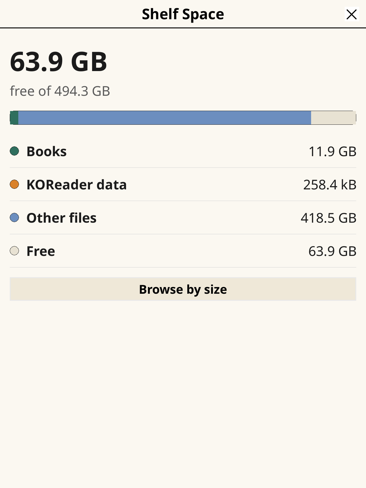
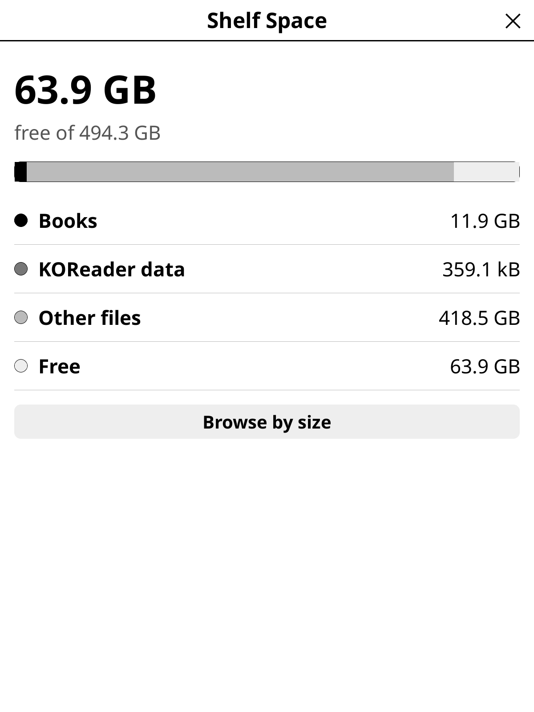

# Shelf Space

A [KOReader](https://github.com/koreader/koreader) plugin to see where your
device storage went and free it up. It uses only KOReader's own APIs, so it is
meant to work on every device KOReader supports; so far it has only been run
in the desktop emulator.

## Screenshots

| Overview (colour) | Overview (grayscale) | Browse by size |
| --- | --- | --- |
|  |  |  |

Taken in the KOReader desktop emulator, so the totals are a Mac's. Colour
shows on Kaleido screens such as the Kobo Libra Colour; other screens get the
grayscale version.

## Status

Early. **Tools › Shelf Space** opens an overview with free space, a usage bar,
and a books / KOReader data / other breakdown. **Browse by size** lists folders
and files largest-first.

## Planned

- Delete with proper sidecar cleanup
- KOReader's own usage (cache, logs, update downloads)
- A shelf view where spine width matches size

## Install

Copy the `shelfspace.koplugin` folder into KOReader's `plugins` directory and
restart KOReader.

## Development

Run the KOReader desktop emulator (`./kodev run`), then link the plugin in:

    ./dev.sh /path/to/koreader/plugins

## License

MIT
