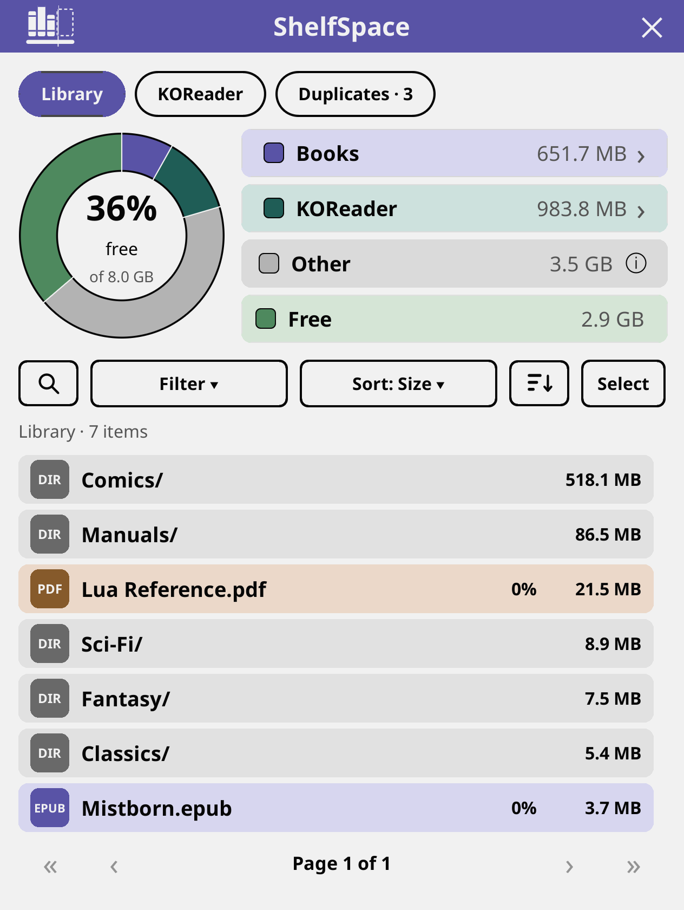
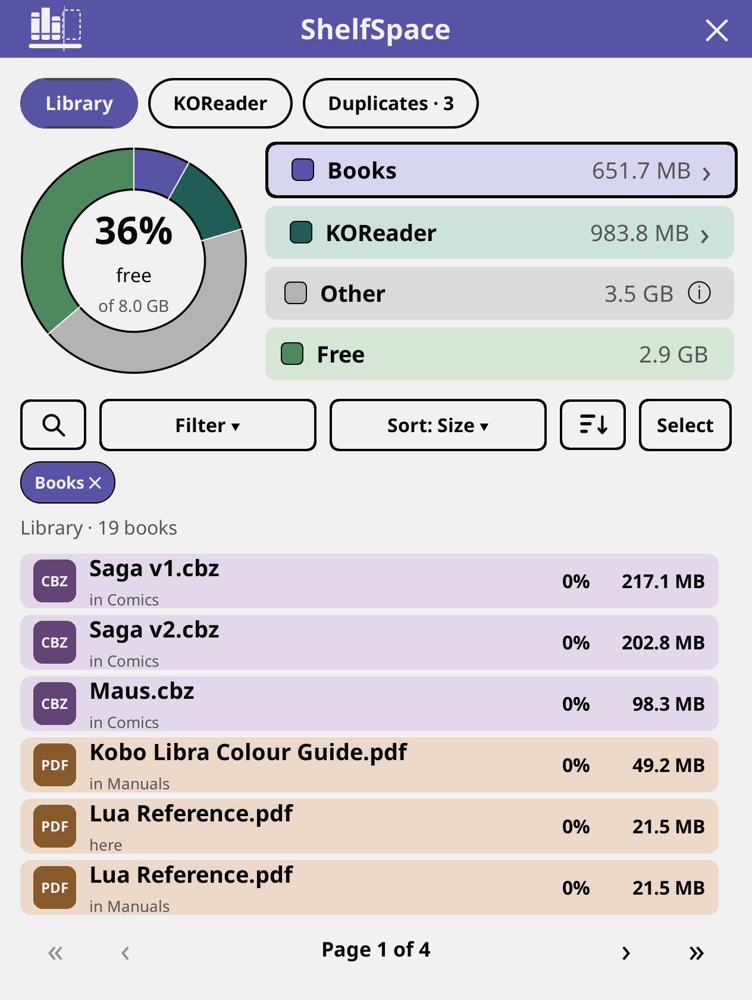
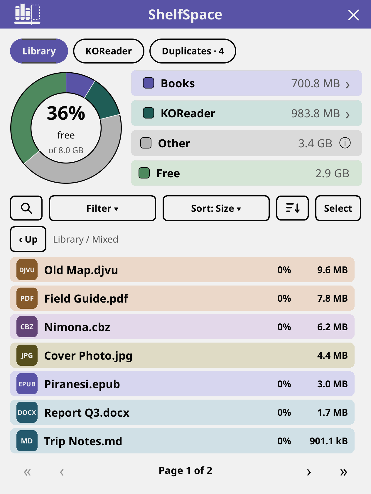
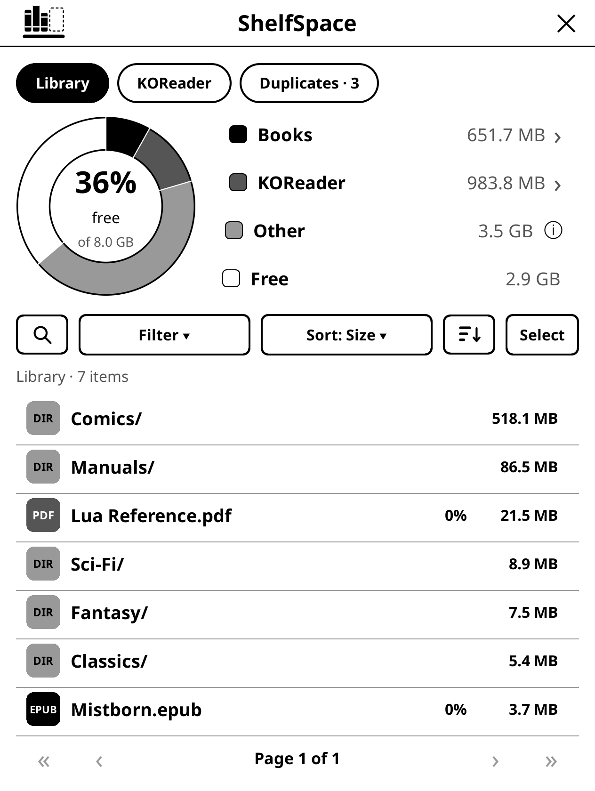

  <picture>
    <source media="(prefers-color-scheme: dark)" srcset="assets/logo-dark.svg">
    
  </picture>

<h1>ShelfSpace</h1>

A [KOReader](https://github.com/koreader/koreader) plugin to see where your
device storage went and free it up. It uses only KOReader's own APIs, so it is
meant to work on every device KOReader supports; so far it has been run in the
desktop emulator, on a Kobo Libra Colour, on a Kindle Paperwhite 6 and on Android.

## Screenshots

| Library | Books, biggest first | Filters |
| --- | --- | --- |
|  |  |  |

| Search | Tick several | File details |
| --- | --- | --- |
|  |  |  |

| Delete | KOReader data | Clear several |
| --- | --- | --- |
|  |  |  |

| File types | On a gray screen | ShelfSpace menu |
| --- | --- | --- |
|  |  |  |

| Sets of copies | Compare and choose | Confirm |
| --- | --- | --- |
|  |  |  |

| Kept on purpose | Changelog | About |
| --- | --- | --- |
|  |  |  |

Taken in the KOReader desktop emulator at Kobo Libra Colour proportions, on a made-up library and an 8 GB
device, so the totals are not a real one's. The colour screenshots are softened with `tools/kaleido-wash.sh`
to look the way a colour e-ink screen (Kaleido) shows them, which is paler than a monitor. On a screen with no
colour, ShelfSpace is black, white and grays, as in the gray one above.

## What it does

Open **Tools › ShelfSpace**. Three tabs:

- **Library**: where your storage went, and your files. At the top a donut chart and its legend:
  books, KOReader's data, other files and free space. The legend is also the controls. Tap **Books** to narrow the
  list to every book in the library, wherever it is (tap it again to go back), or **KOReader** to open that tab; tapping a
  slice does the same. The info icon on **Other** explains what that space is and why it is left alone. Under it, your
  library, largest first. Each row is a card with a tile for its type, on a colour for its kind (see File types
  below), and a **% Read** column showing how far through each book you are (0% to 99%, or Read once it is
  finished), from KOReader's own reading progress. Tap a folder to open it (**‹ Up** takes you back), or tap a file to see
  what it is; pressing and holding any row opens its card too (for a folder, what is in it and what you can
  do with it; for a file its type, size, where it is, when it changed, when you last opened it and your progress,
  with Open and Book info buttons, and, for the book you have open, Close book so you can delete it).
  - **Search** (the magnifier): by name, across the folder you are in and everything under it. Once you
    have searched, the button shows your search and tapping it clears it.
  - **Filter**: by file type, and by **Show**, which narrows the list to the books KOReader has marked as finished, or
    to the ones you never opened, wherever they are in the library, so what you have already read (or never will) is easy
    to clear. What is narrowing the list shows as chips with a ✕, each undoing just that. When a search or filter leaves
    nothing, you get a message saying why and a button that undoes it.
  - **Sort** by size, name, date or when you last opened it; the arrow beside it flips the direction.
  - **Select** turns on checkboxes: tick the rows you want (**Select all** ticks everything that can be deleted), and a
    bar floats over the bottom of the list, so nothing moves under your finger, saying how many are ticked and how big they are,
    with a **Delete** that deletes them in one go. You always get a confirmation first, including how many books lose
    their reading progress.
- **Duplicates**: a tab that appears when a book is in the library more than once (a tidy library never sees it), with how many
  books it holds. It opens on how much clearing the extras would free, then shows each book as a card with its copies: the one
  that stays marked ✓, the others ✕, and what clearing them frees. Copies with the same bytes are marked **Same file**; the
  same name in another format or with a "(1)" on the end is **Same book**; spellings and capitals do not matter, so
  `Dune.epub`, `dune.KEPUB.EPUB` and `DUNE.fb2.zip` are one book. Open one to compare the copies, stacked as cards with
  their file name, size, how far through you are, when they were added and where they are, and tags for what sets one
  apart (the newest, the smallest, an older format). The copy to keep has a heavy outline and a filled radio, and says why:
  the book you are reading, or the copy you have read most, never goes; after that the format that reads best on an
  e-ink screen (EPUB, then MOBI, then the formats that reflow, then fixed layouts such as PDF), then the copy nearest the top
  of the library, then the newest. Tap another copy to keep that one instead. A sentence above the buttons says exactly what
  **Clear** will do, and the confirmation names what it keeps and what it clears. **Keep all** leaves the set alone from then
  on; the sets you kept are under **Kept on purpose** in the menu behind the ShelfSpace mark. It is one book at a time on
  purpose, so every deletion is something you have looked at.
- **KOReader**: what KOReader can rebuild or no longer needs (rendering cache,
  update downloads, crash logs, screenshots, reading progress of books that are
  gone), each with a Clear button. **Select** ticks several to clear together,
  and **Clear all** clears everything listed. Either way you are asked first,
  with a warning that screenshots and reading progress cannot be recovered.

### File types

ShelfSpace knows every format KOReader opens, in any case (`.epub`, `.EPUB` and `.ePub` are the same), and gives each a tile with its
own letters and a colour for its kind. The type filter and the duplicate finder count a format's other spellings as one.

| Kind | Colour | Formats |
| --- | --- | --- |
| Books | indigo | epub (also `.kepub.epub`, `.epub3`), mobi (`.prc`), fb2 (`.fb2.zip`), fb3, pdb, azw |
| Documents | cyan | doc, docx, docm, odt, rtf, txt, md, html (`.htm`), xhtml, htmlz, chm, and `.txt.zip`, `.md.zip`, `.html.zip` and the like |
| Fixed layout | orange | pdf, djvu (`.djv`), xps |
| Comics and archives | purple | cbz, cbt, cbr, zip |
| Pictures | olive | jpg (`.jpeg`), png, bmp, webp, gif, tif, svg and the other image types KOReader shows |
| Folders | gray | |

Only files KOReader itself opens can be deleted here, plus pictures. A format KOReader does not register on your build (for example
`.azw3`, `.kfx`, `.text`, `.markdown` or `.oxps` in KOReader's 2026.07 nightlies) is listed as a locked file, with the reason, until you
set an "open with" for it in KOReader.

## Safety

Deleting is permanent: there is no trash. Every delete asks first, naming what goes. Only
books KOReader can open, and folders holding nothing else, can be deleted; system folders,
KOReader's own folder and the book you are reading are locked. If the library matters to
you, keep a copy elsewhere.

## Tested on

| Device | KOReader | Status |
| --- | --- | --- |
| Kobo Libra Colour | v2026.07.1 and v2026.07.2 | Works (the colour screen), including updating itself from the About card |
| KOReader desktop emulator (macOS) | nightly 2026.07.2 | Works |
| Kindle Paperwhite 6 (12th gen) | v2026.07.2 | Works, [reported by a user](https://github.com/ghepting/shelfspace.koplugin/issues/56) |
| Android | not stated | Works, [reported on Reddit](https://www.reddit.com/r/koreader/comments/1xfe6r4/i_made_my_first_koreader_plugin/) by a user |

Anything else is untested. If you try it on another device, please
[tell us how it went](https://github.com/ghepting/shelfspace.koplugin/issues/new?template=device_report.yml).

## About and updates

The ShelfSpace mark at the top left of the screen opens a menu (the ✕ at the top right closes ShelfSpace). It holds **About**, **Check for updates**, **Changelog**, **Kept on purpose** (when you have set some aside) and **Exit ShelfSpace**. **About** shows which ShelfSpace this is (version, release date
and commit), what it is running on, and QR codes for the repository and for reporting a
problem, with your device and versions already filled in. **Check for updates** asks GitHub
for the latest release, only when you tap it, and tells you what changed if there is a newer one.

You can do all of that without opening ShelfSpace: in KOReader's Tools menu, ShelfSpace is a submenu with
**Open ShelfSpace** (or **Close**), **About**, **Check for updates** and **Changelog**. The changelog shows the
notes of every release, one per page, newest first, with Older and Newer to move between them. It is fetched from
GitHub the first time you open it and kept on the device, so after that it reads offline; **Refresh** pulls newer
releases. (Bookshelf's start menu can launch ShelfSpace too: Add to menu, Plugin, ShelfSpace.)

## Scan speed

The last scan is kept in KOReader's cache folder (`cache/shelfspace/scan.lua`). The next
one only reads folders whose modification time changed. KOReader's own data folder is always
read afresh, since its files change in place. Delete the file to force a full scan.

## Install

Download `shelfspace.koplugin.zip` from the
[latest release](https://github.com/ghepting/shelfspace.koplugin/releases/latest), unzip it
into KOReader's `plugins` directory and restart KOReader.

ShelfSpace is 0.x: it has been run in the desktop emulator, on one Kobo
(Libra Colour) and, by users' reports, on a Kindle Paperwhite 6 and on Android. Reports from other devices are welcome.

## Development

Run the KOReader desktop emulator (`./kodev run`), then link the plugin in:

    ./dev.sh /path/to/koreader/plugins

Screenshots in this README are taken by `tools/screenshots/run.sh /path/to/KOReader.app`: it builds a sample library and a made-up
8 GB device, drives ShelfSpace through every screen in the desktop emulator, checks it as it goes (what may be deleted, every
file type in any case, duplicates, the filters), and then washes the colour screenshots with `tools/kaleido-wash.sh`, which
mutes them to how a Kaleido colour e-ink screen shows them. Add `--readme` to put the washed ones in `assets/`. Every screenshot in
this repository goes through that wash; run `tools/kaleido-wash.sh shot.png` on any other colour capture, once.

`tools/make-wordmark.py` draws the name under the logo as outlines from a font
file; the result is already in `shelfspace.koplugin/shelfspace/icons.lua`.

## Contributing

Pull requests are squash-merged, so the title must be a conventional commit:
`feat:`, `fix:`, `docs:`, `chore:`, `test:`, `refactor:` (`feat!:` for a breaking
change). Releases are automatic: release-please keeps a "release" pull request open
from those titles (a `fix` bumps the patch version, a `feat` the minor one) and
merging it tags the release and attaches `shelfspace.koplugin.zip`.

## Tests

The logic runs under plain `luajit`, without KOReader: what may be deleted and
why (system folders, KOReader itself, the book being read), how a selection
collapses, search, sort and the file type filter, the share chips, orphaned
reading progress, the donut's geometry and the icons:

    tests/run.sh

## License

MIT
