

  <picture>
    <source media="(prefers-color-scheme: dark)" srcset="assets/logo-dark.svg">
    
  </picture>

<h1>ShelfSpace</h1>

A [KOReader](https://github.com/koreader/koreader) plugin to see where your
device storage went and free it up. It uses only KOReader's own APIs, so it is
meant to work on every device KOReader supports; so far it has been run in the
desktop emulator, on a Kobo Libra Colour and on Android.

## Screenshots

| Overview | Browse by size | Quick filters |
| --- | --- | --- |
| 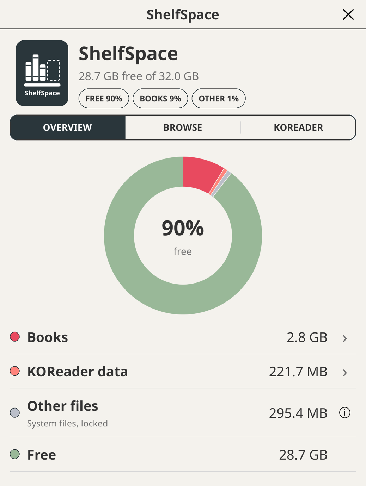 | 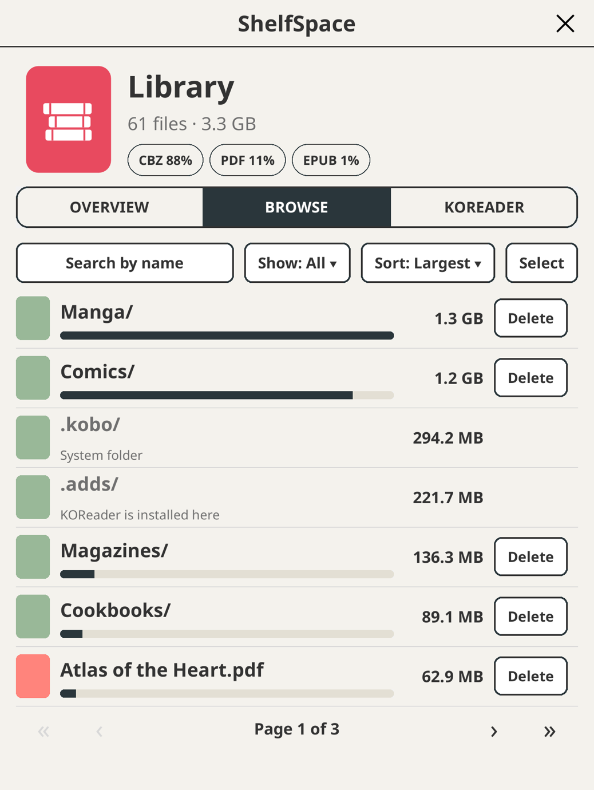 | 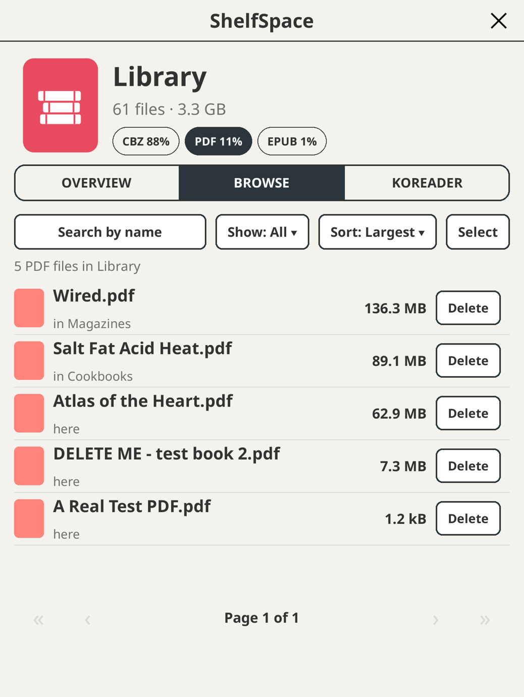 |

| Search and sort | Select several | File details |
| --- | --- | --- |
| 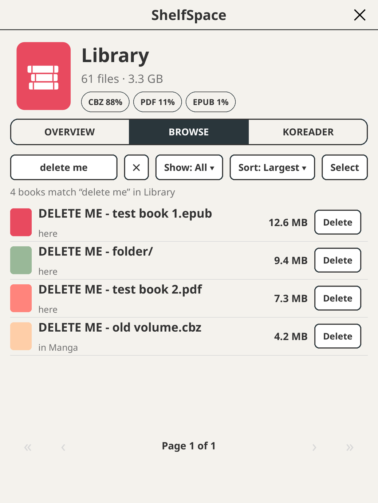 | 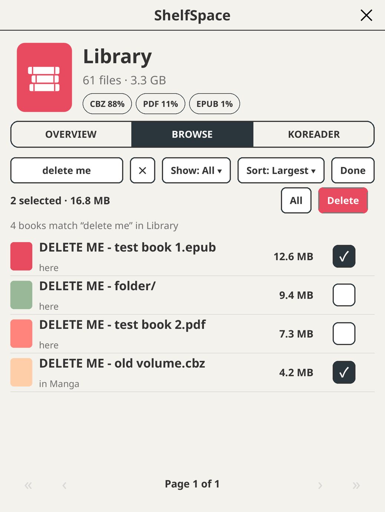 | 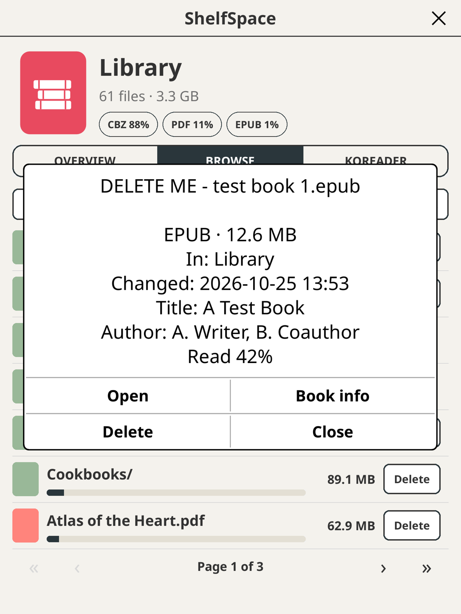 |

| Delete | KOReader data | Clear several |
| --- | --- | --- |
| 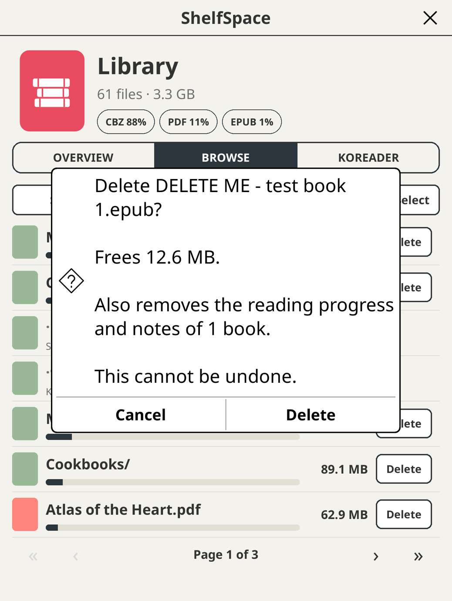 | 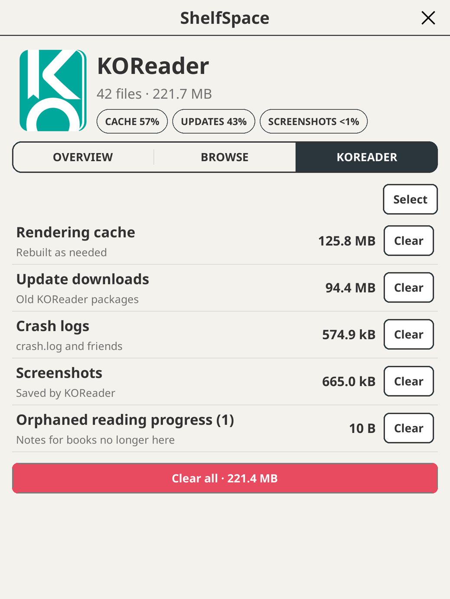 | 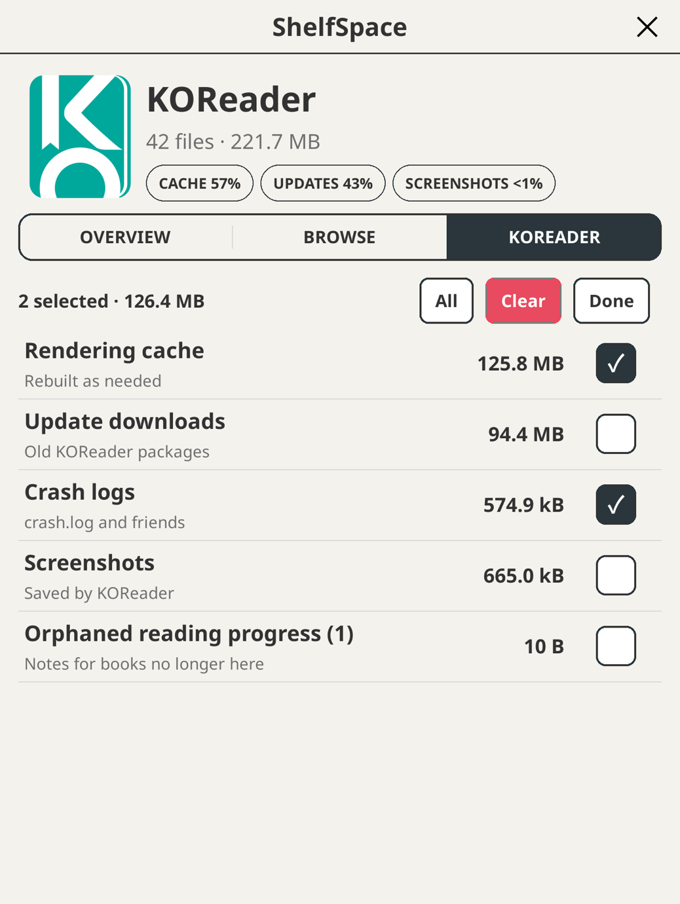 |

| Show menu | Finished books |
| --- | --- |
| 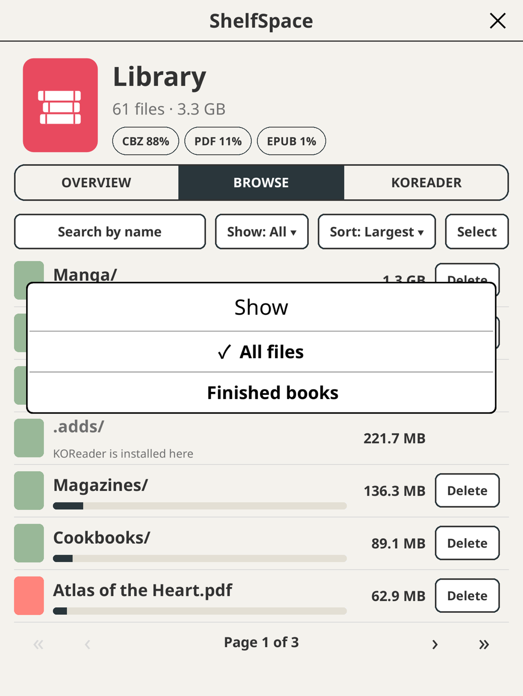 | 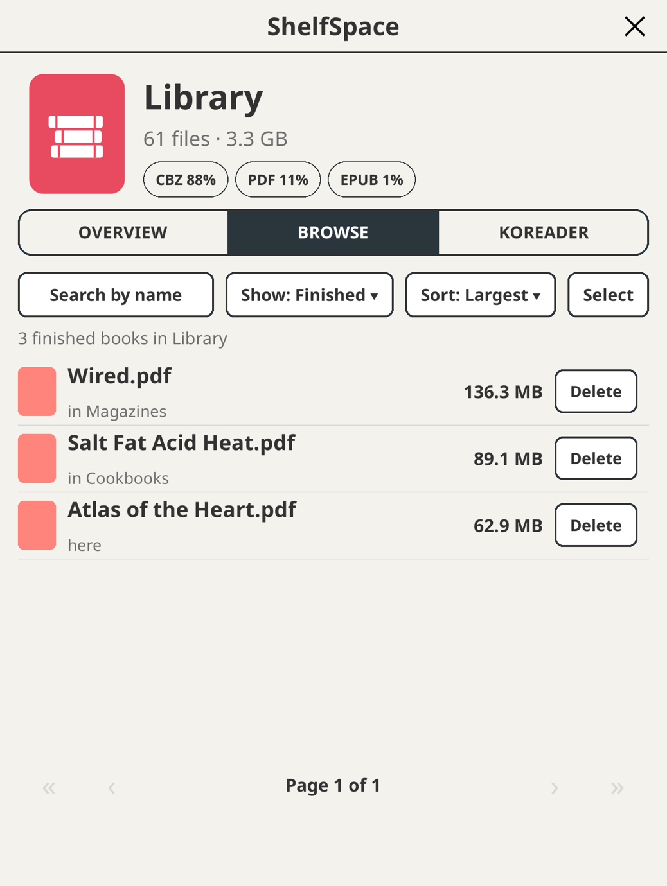 |

Taken in the KOReader desktop emulator at Kobo Libra Colour proportions, so the
totals are a Mac's. Colour shows on Kaleido screens such as the Libra Colour;
other screens get a grayscale version of the same layout.

## What it does

Open **Tools › ShelfSpace**. Three tabs:

- **Overview**: free space as a donut chart, and where the rest went (books,
  KOReader data, everything else). Tap a slice or a row to jump to Books or
  KOReader data; the info icon on Other files explains what that space is and
  why it is left alone.
- **Browse**: your library, largest first, with a share bar per row. The file
  type chips at the top are quick filters: tap one to show only that type
  (tap it again to clear). Sort by size, name or date, or search by name across
  the folder you are in and everything under it. **Show** narrows the list to the
  books KOReader has marked as finished, wherever they are in the library, so what
  you have already read is easy to clear. Tap a folder to open it, or tap
  a file to see what it is (type, size, where it is, when it changed, your
  reading progress), with Open and Book info buttons. Every row has its own
  **Delete** button, or tap **Select** to tick several rows and delete them in
  one go. You always get a confirmation first, including how many books lose
  their reading progress. Only books KOReader can open, and folders holding
  nothing else, can be deleted here. Anything else (system folders, other
  files) is shown with the reason it is locked, and so are KOReader itself and
  the book you are reading.
- **KOReader**: what KOReader can rebuild or no longer needs (rendering cache,
  update downloads, crash logs, screenshots, reading progress of books that are
  gone), each with a Clear button. **Select** ticks several to clear together,
  and **Clear all** clears everything listed. Either way you are asked first,
  with a warning that screenshots and reading progress cannot be recovered.

## Safety

Deleting is permanent: there is no trash. Every delete asks first, naming what goes. Only
books KOReader can open, and folders holding nothing else, can be deleted; system folders,
KOReader's own folder and the book you are reading are locked. If the library matters to
you, keep a copy elsewhere.

## Tested on

| Device | KOReader | Status |
| --- | --- | --- |
| Kobo Libra Colour | v2026.07.1 | Works (the colour screen) |
| KOReader desktop emulator (macOS) | nightly 2026.07.2 | Works |
| Android | not stated | Works, [reported on Reddit](https://www.reddit.com/r/koreader/comments/1xfe6r4/i_made_my_first_koreader_plugin/) by a user |

Anything else is untested. If you try it on another device, please
[tell us how it went](https://github.com/ghepting/shelfspace.koplugin/issues/new?template=device_report.yml).

## Scan speed

The last scan is kept in KOReader's cache folder (`cache/shelfspace/scan.lua`). The next
one only reads folders whose modification time changed. KOReader's own data folder is always
read afresh, since its files change in place. Delete the file to force a full scan.

## Install

Download `shelfspace.koplugin.zip` from the
[latest release](https://github.com/ghepting/shelfspace.koplugin/releases/latest), unzip it
into KOReader's `plugins` directory and restart KOReader.

ShelfSpace is 0.x: it has been run in the desktop emulator, on one Kobo
(Libra Colour) and, by a user's report, on Android. Reports from other devices are welcome.

## Development

Run the KOReader desktop emulator (`./kodev run`), then link the plugin in:

    ./dev.sh /path/to/koreader/plugins

`tools/make-wordmark.py` draws the name under the logo as outlines from a font
file; the result is already in `shelfspace.koplugin/shelfspace/icons.lua`.

## Contributing

Pull requests are squash-merged, so the title must be a conventional commit:
`feat:`, `fix:`, `docs:`, `chore:`, `test:`, `refactor:` (`feat!:` for a breaking
change). Releases are automatic: release-please keeps a "release" pull request open
from those titles (a `fix` bumps the patch version, a `feat` the minor one) and
merging it tags the release and attaches `shelfspace.koplugin.zip`.

## Tests

The logic runs under plain `luajit`, without KOReader: what may be deleted and
why (system folders, KOReader itself, the book being read), how a selection
collapses, search, sort and the file type filter, the share chips, orphaned
reading progress, the donut's geometry and the icons:

    tests/run.sh

## License

MIT

The colours are the design tokens in [`assets/theme.json`](assets/theme.json), also saved as the
[shelfspace.koreader palette](https://www.colourlovers.com/palette/4987334/shelfspacekoreader) on
COLOURlovers. It is built on [Coup de Grâce](https://www.colourlovers.com/palette/1098589/coup-de-grce),
with two neutrals added, on a beige page.
