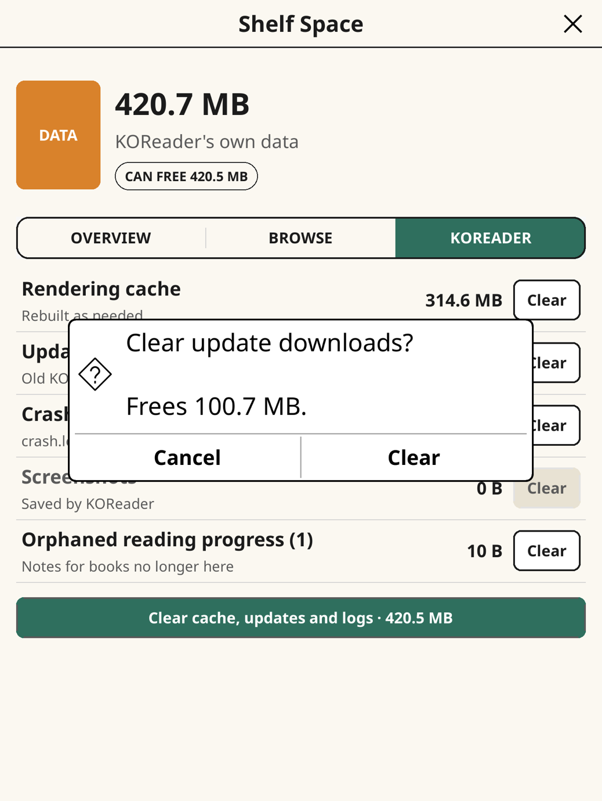

# Shelf Space

A [KOReader](https://github.com/koreader/koreader) plugin to see where your
device storage went and free it up. It uses only KOReader's own APIs, so it is
meant to work on every device KOReader supports; so far it has been run in the
desktop emulator and on a Kobo Libra Colour.

## Screenshots

| Overview | Browse by size | Search and sort |
| --- | --- | --- |
|  |  |  |

| File details | Delete | KOReader data |
| --- | --- | --- |
|  |  |  |

| Clear |
| --- |
|  |

Taken in the KOReader desktop emulator at Kobo Libra Colour proportions, so the
totals are a Mac's. Colour shows on Kaleido screens such as the Libra Colour;
other screens get a grayscale version of the same layout.

## What it does

Open **Tools › Shelf Space**. Three tabs:

- **Overview**: free space as a donut chart, and where the rest went (books,
  KOReader data, everything else). Tap a slice or a row to jump to Books or
  KOReader data; the info icon on Other files explains what that space is and
  why it is left alone.
- **Browse**: your library, largest first, with a share bar per row. Sort by
  size, name or date, or search by name across the folder you are in and
  everything under it. Tap a folder to open it, or tap a file to see what it is
  (type, size, where it is, when it changed, your reading progress), with Open
  and Book info buttons. Every row has its own **Delete** button, and you
  always get a confirmation first, including how many books lose their reading
  progress. Only books KOReader can open, and folders holding nothing else, can
  be deleted here. Anything else (system folders, other files) is shown with
  the reason it is locked, and so are KOReader itself and the book you are
  reading.
- **KOReader**: what KOReader can rebuild or no longer needs (rendering cache,
  update downloads, crash logs, screenshots, reading progress of books that are
  gone), each with a Clear button.

## Planned

- Select several files at once
- A shelf view where spine width matches size
- A faster scan with a cached result

## Install

Copy the `shelfspace.koplugin` folder into KOReader's `plugins` directory and
restart KOReader.

## Development

Run the KOReader desktop emulator (`./kodev run`), then link the plugin in:

    ./dev.sh /path/to/koreader/plugins

## License

MIT
