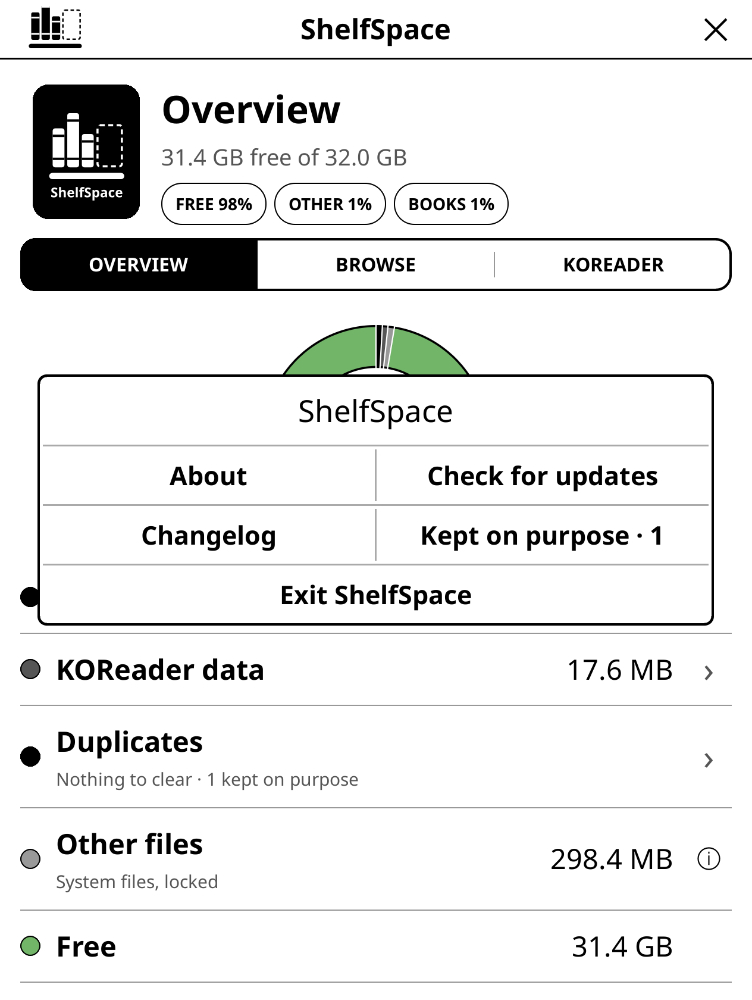
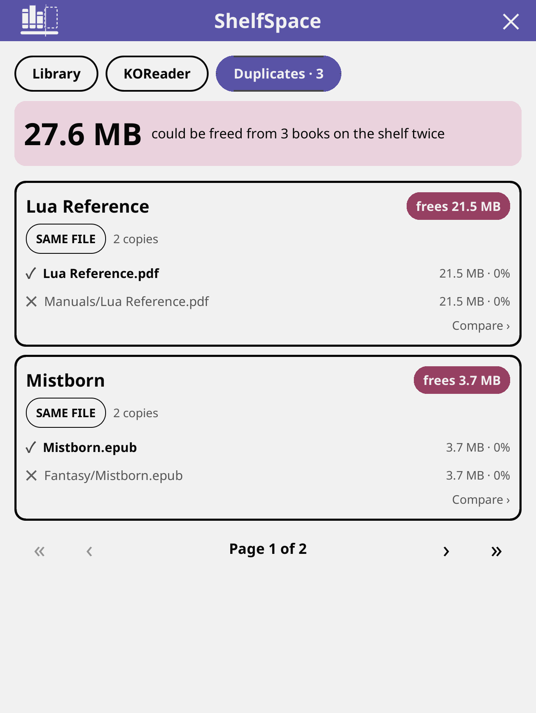
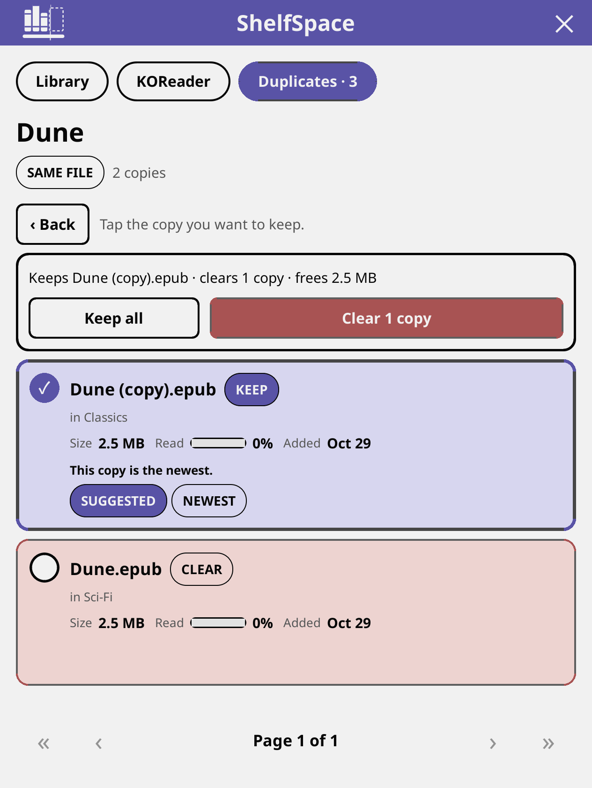
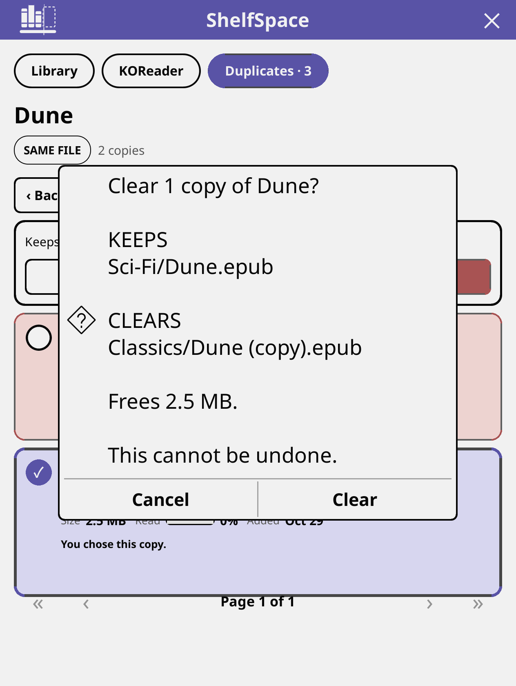
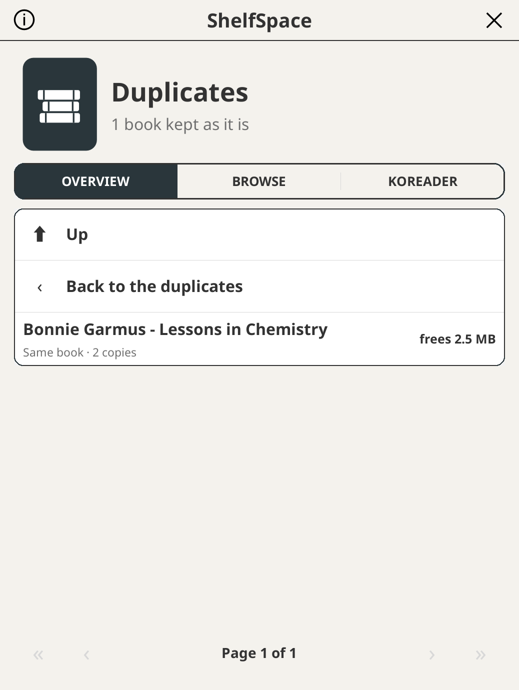
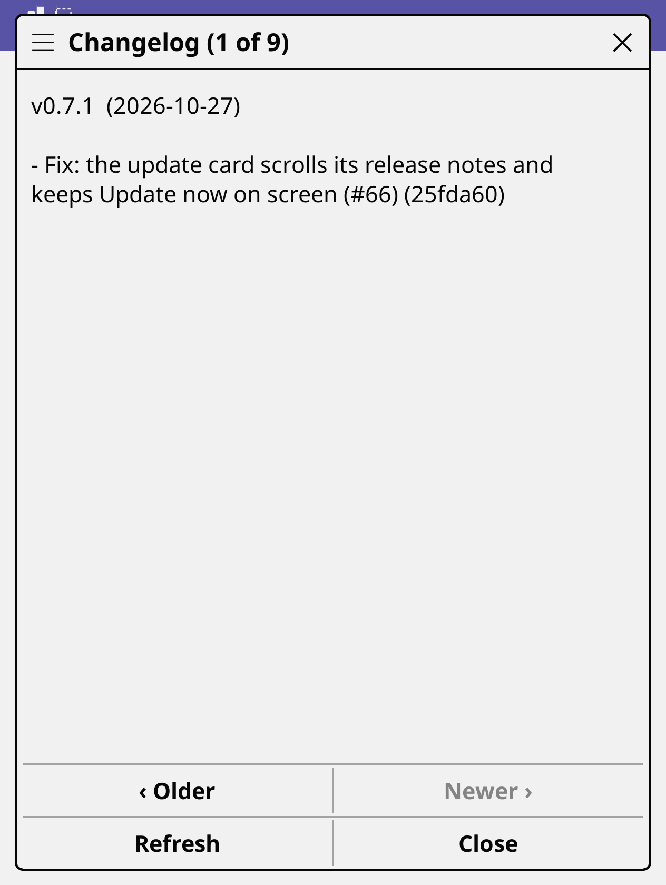
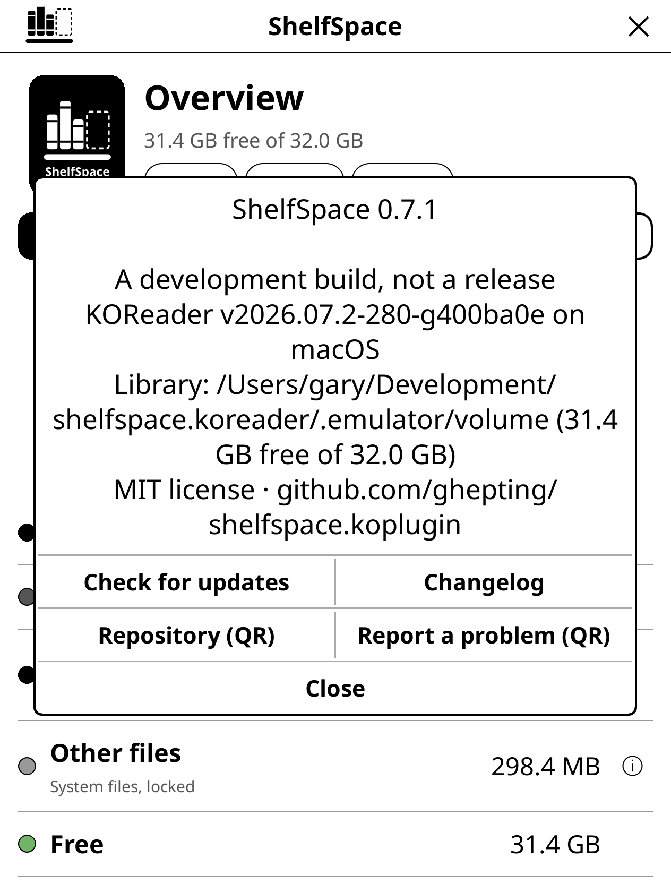

  <picture>
    <source media="(prefers-color-scheme: dark)" srcset="assets/logo-dark.svg">
    
  </picture>

<h1>ShelfSpace</h1>

A [KOReader](https://github.com/koreader/koreader) plugin to see where your
device storage went and free it up. It uses only KOReader's own APIs, so it is
meant to work on every device KOReader supports; so far it has been run in the
desktop emulator, on a Kobo Libra Colour, on a Kindle Paperwhite 6 and on Android.

## Screenshots

| Overview | Browse by size | Quick filters |
| --- | --- | --- |
|  |  |  |

| Search and sort | Tick several | File details |
| --- | --- | --- |
|  |  |  |

| Delete | KOReader data | Clear several |
| --- | --- | --- |
|  |  |  |

| Show menu | Finished books | ShelfSpace menu |
| --- | --- | --- |
|  |  |  |

| Sets of copies | Compare and choose | Confirm |
| --- | --- | --- |
|  |  |  |

| Kept on purpose | Changelog | About |
| --- | --- | --- |
|  |  |  |

Taken in the KOReader desktop emulator at Kobo Libra Colour proportions, so the
totals are a Mac's. ShelfSpace is plain black and white with grays, like KOReader
itself; the one colour is a green for free space, which shows on colour screens
such as the Libra Colour.

## What it does

Open **Tools › ShelfSpace**. Three tabs:

- **Overview**: free space as a donut chart, and where the rest went (books,
  KOReader data, everything else). Tap a slice or a row to jump to Books or
  KOReader data; the info icon on Other files explains what that space is and
  why it is left alone.
- **Browse**: your library, largest first. A **% Read** column shows how far through
  each book you are (0% to 99%, or Read once it is finished), from KOReader's own
  reading progress. The file
  type chips at the top are quick filters: tap one to show only that type
  (tap it again to clear). Sort by size, name, date or when you last opened it (the arrow beside the sort flips the direction), or search by name (the magnifier tag after the types; once you have searched, the tag shows your search and tapping it clears it) across
  the folder you are in and everything under it. **Show** narrows the list to the
  books KOReader has marked as finished, or to the ones you never opened,
  wherever they are in the library, so what you have already read (or never
  will) is easy to clear. When a search or filter leaves nothing, you get a message
  saying why and a button that undoes it. Tap a folder to open it, or tap
  a file to see what it is; pressing and holding any row opens its card (for a folder, what is in it and what you can do with it) (type, size, where it is, when it changed, your
  reading progress), with Open and Book info buttons, and, for the book you have open, Close book so you can delete it. Every row has a checkbox;
  tick the ones you want (the checkbox in the header ticks them all) a bar
  floats over the bottom of the list, so nothing moves under your finger, saying how
  many are ticked and how big they are, with a **Delete** that deletes them in one go. You always get a confirmation first, including how many books lose
  their reading progress. Only books KOReader can open, and folders holding
  nothing else, can be deleted here. Anything else (system folders, other
  files) is shown with the reason it is locked, and so are KOReader itself and
  the book you are reading.
- **Duplicates**: when a book is in the library more than once, a Duplicates row appears
  on Overview (a tidy library never sees it). It lists each book that has several copies, with how
  much clearing the extras would free. Copies with the same bytes are marked **Same file**; the
  same name in another format or with a "(1)" on the end is **Same book**. Open one to compare the
  copies, stacked as cards with their file name, size, how far through you are, when they were added and where they are,
  and tags for what sets one apart (the newest, the smallest, an older format). One copy is
  marked **Keep**, and it says why: the book you are reading, or the copy you have read most,
  never goes; after that the format that reads best on an e-ink screen (EPUB, then MOBI, then
  PDF), then the copy nearest the top of the library, then the newest. Tap another copy to keep that
  one instead. **Clear** removes the others after a confirmation that names them, and **Keep all**
  leaves the set alone from then on.
  It is one book at a time on purpose, so every deletion is something you have looked at.
- **KOReader**: what KOReader can rebuild or no longer needs (rendering cache,
  update downloads, crash logs, screenshots, reading progress of books that are
  gone), each with a Clear button. **Select** ticks several to clear together,
  and **Clear all** clears everything listed. Either way you are asked first,
  with a warning that screenshots and reading progress cannot be recovered.

## Safety

Deleting is permanent: there is no trash. Every delete asks first, naming what goes. Only
books KOReader can open, and folders holding nothing else, can be deleted; system folders,
KOReader's own folder and the book you are reading are locked. If the library matters to
you, keep a copy elsewhere.

## Tested on

| Device | KOReader | Status |
| --- | --- | --- |
| Kobo Libra Colour | v2026.07.1 and v2026.07.2 | Works (the colour screen), including updating itself from the About card |
| KOReader desktop emulator (macOS) | nightly 2026.07.2 | Works |
| Kindle Paperwhite 6 (12th gen) | v2026.07.2 | Works, [reported by a user](https://github.com/ghepting/shelfspace.koplugin/issues/56) |
| Android | not stated | Works, [reported on Reddit](https://www.reddit.com/r/koreader/comments/1xfe6r4/i_made_my_first_koreader_plugin/) by a user |
| Kobo Clara Colour | not stated | Works, [reported on Reddit](https://www.reddit.com/r/koreader/comments/1xfe6r4/comment/19rt1oz4v5tgh/) by a user |

Anything else is untested. If you try it on another device, please
[tell us how it went](https://github.com/ghepting/shelfspace.koplugin/issues/new?template=device_report.yml).

## About and updates

The ShelfSpace mark at the top left of the screen opens a menu (the ✕ at the top right closes ShelfSpace). It holds **About**, **Check for updates**, **Changelog**, **Kept on purpose** (when you have set some aside) and **Exit ShelfSpace**. **About** shows which ShelfSpace this is (version, release date
and commit), what it is running on, and QR codes for the repository and for reporting a
problem, with your device and versions already filled in. **Check for updates** asks GitHub
for the latest release, only when you tap it, and tells you what changed if there is a newer one.

You can do all of that without opening ShelfSpace: in KOReader's Tools menu, ShelfSpace is a submenu with
**Open ShelfSpace** (or **Close**), **About**, **Check for updates** and **Changelog**. The changelog shows the
notes of every release, one per page, newest first, with Older and Newer to move between them. It is fetched from
GitHub the first time you open it and kept on the device, so after that it reads offline; **Refresh** pulls newer
releases. (Bookshelf's start menu can launch ShelfSpace too: Add to menu, Plugin, ShelfSpace.)

## Scan speed

The last scan is kept in KOReader's cache folder (`cache/shelfspace/scan.lua`). The next
one only reads folders whose modification time changed. KOReader's own data folder is always
read afresh, since its files change in place. Delete the file to force a full scan.

## Install

Download `shelfspace.koplugin.zip` from the
[latest release](https://github.com/ghepting/shelfspace.koplugin/releases/latest), unzip it
into KOReader's `plugins` directory and restart KOReader.

ShelfSpace is 0.x: it has been run in the desktop emulator, on one Kobo
(Libra Colour) and, by users' reports, on a Kobo Clara Colour, a Kindle Paperwhite 6 and on Android. Reports from other devices are welcome.

## Development

Run the KOReader desktop emulator (`./kodev run`), then link the plugin in:

    ./dev.sh /path/to/koreader/plugins

`tools/make-wordmark.py` draws the name under the logo as outlines from a font
file; the result is already in `shelfspace.koplugin/shelfspace/icons.lua`.

## Contributing

Pull requests are squash-merged, so the title must be a conventional commit:
`feat:`, `fix:`, `docs:`, `chore:`, `test:`, `refactor:` (`feat!:` for a breaking
change). Releases are automatic: release-please keeps a "release" pull request open
from those titles (a `fix` bumps the patch version, a `feat` the minor one) and
merging it tags the release and attaches `shelfspace.koplugin.zip`.

## Tests

The logic runs under plain `luajit`, without KOReader: what may be deleted and
why (system folders, KOReader itself, the book being read), how a selection
collapses, search, sort and the file type filter, the share chips, orphaned
reading progress, the donut's geometry and the icons:

    tests/run.sh

## License

MIT
